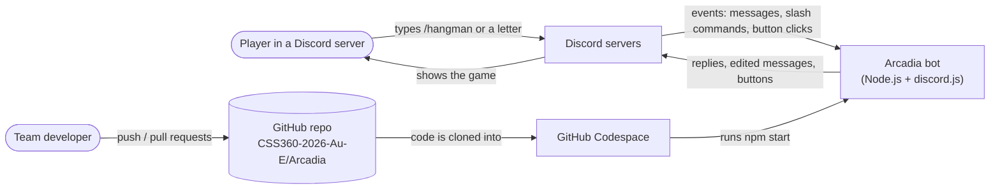

# Arcadia Architecture Guide

Arcadia is a Discord bot that turns a server into a small arcade. Players type a slash command such as `/hangman` and play the game right in the channel. This guide explains how the bot is built, for three readers: a teammate adding a new game, a player curious how it works, and anyone reviewing our code.

## Contents

1. [Overview and system context](#1-overview-and-system-context) (Amrit)
2. [Code design: minigolf modules, and how to add a new game](#2-code-design-minigolf-modules-and-how-to-add-a-new-game) (Abhi)
3. [Game flow: one Hot Potato round](#3-game-flow-one-hot-potato-round) (Jennifer)
4. [Network and tooling: how the bot connects and runs](#4-network-and-tooling-how-the-bot-connects-and-runs) (Jason)

---

## 1. Overview and system context

### What talks to what

Arcadia never runs inside Discord. It is a Node.js program that runs somewhere else (for us, a GitHub Codespace) and keeps a live connection open to Discord. Players only ever see Discord. Discord passes their messages and slash commands to the bot, and the bot sends its replies back through Discord.

| Part | What it does |
|---|---|
| Player | Types commands and guesses in a Discord channel. Needs nothing installed. |
| Discord | Hosts the server and channels. Sends every event the bot asked for to the bot, and shows what the bot sends back. |
| Arcadia bot | Our code. Decides what each event means and what to reply. |
| GitHub Codespace | The cloud computer where the bot actually runs while we develop and demo. |
| GitHub repo | Where the code lives. Every change goes in through a pull request. |

### How the code is organized

The code has two kinds of files, kept in two folders on purpose:

- **`src/games/`** holds the **rules** of each game. These files never talk to Discord. For example, `hangman.js` only knows how to pick a word, check a guess and draw the gallows. Because the rules are plain functions, we can test them with Mocha (`tests/hangman.spec.js`) without a Discord server.
- **`src/events/`** holds the **Discord glue**. Each file listens for one kind of Discord event, reads what the player did, calls the rules in `src/games/`, and sends the answer back.

This split means a bug in "how hangman works" lives in one place, and a bug in "how we talk to Discord" lives in another.

### How the bot starts

1. `npm start` builds the code with esbuild and runs `build/app.js`. The secret bot token comes from the `.env` file.
2. `src/app.js` creates the discord.js `Client`. It asks Discord for four kinds of events (called intents): servers, server members, messages, and the text inside messages.
3. `loadEvents()` in `src/helpers/loadEvents.js` reads **every** `.js` file in `src/events/`. Each file exports an object with a `name` (which Discord event), an `execute` function, and an optional `once`. The loader hooks each one up with `client.on(name, execute)`.
4. The bot logs in. Discord fires the `ready` event once, and `src/events/ready.js` registers the five slash commands (`/hangman`, `/songguess`, `/minigolf`, `/hotpotato`, `/tictactoe`) in every server the bot is in.

The loader in step 3 is the key pattern in this bot. Nobody has to edit `app.js` to add a feature. You drop a new file in `src/events/` and it is picked up the next time the bot starts. Several files can listen to the same event. For example, `messageCreate.js`, `hotpotatoMessages.js` and `songguessMessages.js` all run on every message, and each one ignores messages that are not meant for its game.

### Data flow: one hangman guess

This diagram follows a single typed letter through the system. It uses data flow diagram notation: rounded boxes are things outside our code, plain boxes are steps our code does, and the cylinder is stored data.

Step by step:

1. **Filter.** `messageCreate.js` drops messages from bots (so the bot never answers itself) and anything longer than one character, so people can still chat during a game. It looks up the channel's game in the `games` Map. If that channel has no game, it stops.
2. **Apply the rules.** `guess()` in `hangman.js` lowercases the letter and checks it against the word. It returns one word that says what happened: `invalid`, `repeat`, `hit`, `miss`, `won` or `lost`. It also updates the game object (adds the letter, counts a wrong guess).
3. **Reply.** `messageCreate.js` turns that result into a message. `showGame()` draws the gallows and the hidden word (`p _ x _ l`) inside a code block, so the picture lines up. When the game is won or lost, the game is deleted from the Map so the channel is free for a new one.

A game starts the same way from the other side. `/hangman` arrives as an `interactionCreate` event, and `interactionCreate.js` creates a game and stores it in the Map. If the channel already has a game, it replies only to that player (an ephemeral reply) and does not start a second one.

### Design choices and their limits

- **Games live in memory.** The `games` Map is just a variable. It is fast and simple, but every running game is lost when the bot restarts. A database would fix that, at the cost of more setup.
- **One game per channel.** Keying games by channel ID keeps guesses from different games apart without asking players to type a game ID.
- **Anyone in the channel can guess.** Hangman is a group game, so the bot does not track turns.

---

## 2. Code design: minigolf modules, and how to add a new game

_Abhiram: class/module diagram of the minigolf files, plus the steps for adding a new game._

---

## 3. Game flow: one Hot Potato round

This section shows what each person and part of the system can do in Hot Potato, then walks through one round. The use-case diagram shows the three actors: the **Host** (the player who types `/hotpotato`), any **Player**, and the bot's **Timer**, which triggers steps on its own. Each oval is something an actor can do. A dashed «include» arrow means one step always happens as part of another (starting a game always adds the host). A dashed «extend» arrow means a step only happens sometimes, under the condition in brackets (the winner is announced only when one player is left).

Step by step:

1. **Start.** A player types `/hotpotato`. It arrives as an `interactionCreate` event, and `hotpotatoCommand.js` checks the `games` Map. If the channel already has a game, it replies only to that player (an ephemeral reply) and stops. Otherwise it creates a new game, adds the player who started it, and stores it in the Map.
2. **Join.** The bot opens a 30-second join window. `hotpotatoMessages.js` watches for messages that say `join` and calls `join()` in `hotpotato.js`, which adds the player and returns `joined`, `already` or `closed`. The bot reacts with 🥔 to each new player. Every other message is ignored, so people can still chat.
3. **Close joining.** When the 30 seconds are up, `canStart()` checks for at least 2 players. If there are fewer, the game is cancelled and deleted from the Map.
4. **Hand out the potato.** `startRound()` switches the game to `playing` and gives the potato to a random player. The bot then starts a secret fuse timer. `fuseSeconds()` picks a random length between 10 and 30 seconds, so nobody can predict when it will go off.
5. **Pass.** While the fuse runs, the player holding the potato passes it by @mentioning someone. `pass()` checks three rules in order: the sender must be holding the potato, they can't pass to themselves, and the target must still be in the game. It returns `passed`, `not-holder`, `self` or `not-playing`, and the bot replies to match. A pass from someone who isn't holding the potato gets no reply, so normal chatting doesn't cause spam.
6. **Explode.** When the fuse runs out, `explode()` removes whoever is holding the potato and adds them to the `out` list.
7. **Next round or winner.** If more than one player is left, a new round starts after a 3-second pause (back to step 4). If only one is left, `winner()` returns them, the bot announces the winner, and the game is deleted from the Map so the channel is free for a new one.

### Design choices and their limits

- **Rules and timers are kept apart.** `hotpotato.js` only holds the rules. The timers (`setTimeout`) live in `hotpotatoCommand.js`. That lets the tests call `explode()` directly instead of waiting up to 30 seconds.
- **Timers check that their game still exists.** Before acting, each timer checks the game is still in the Map, so an old timer can't post into a new game.
- **Players are stored by user ID.** IDs never change and are what @mentions contain, so passing works even if someone changes their name.
- **Games live in memory.** Like hangman, a game in progress is lost if the bot restarts.
- **Players who leave stay in the game.** A player who leaves the server mid-game stays in the player list until the potato explodes on them.

---

## 4. Network and tooling: how the bot connects and runs

_ovjason: network diagram (Codespace, token in `.env`, Discord gateway), plus how npm, esbuild and the Docker deploy workflow fit in._
