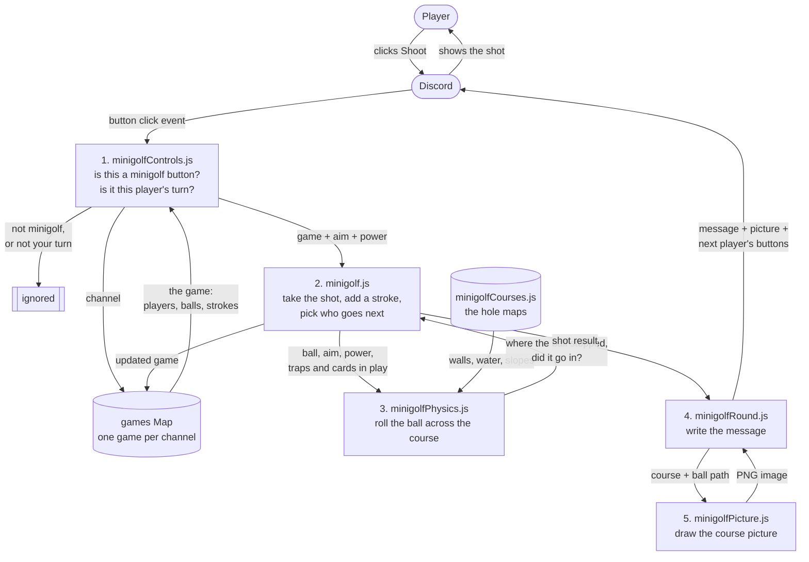
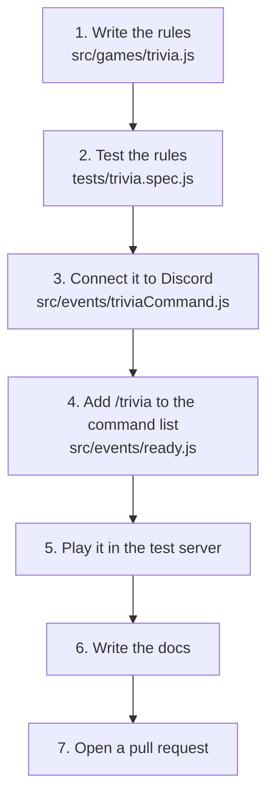
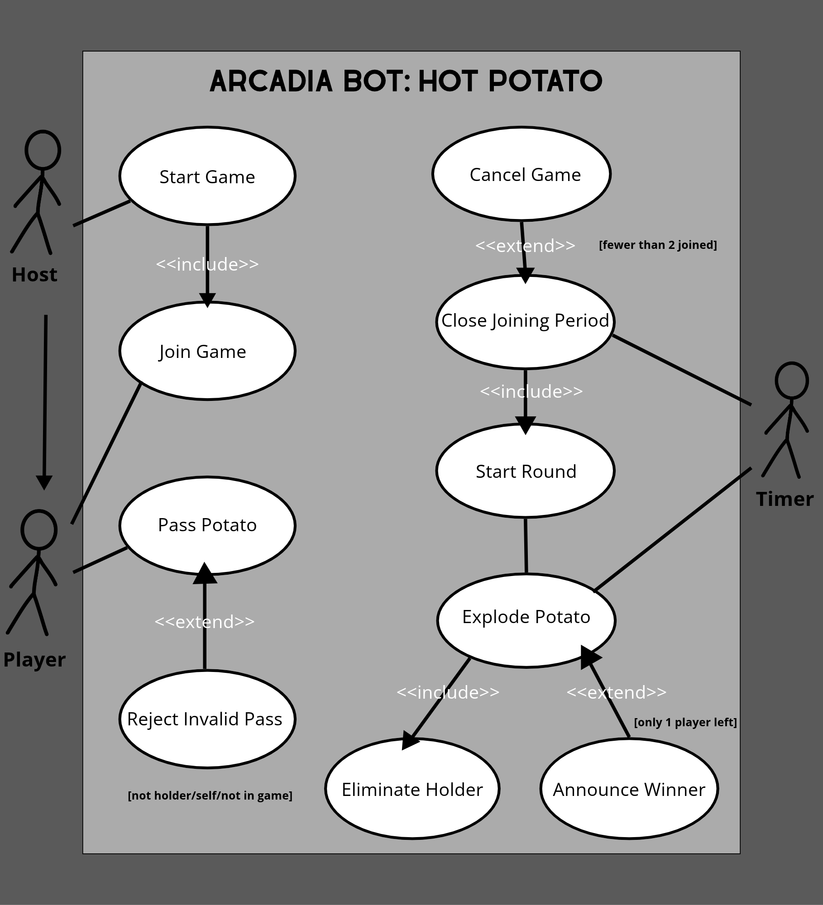
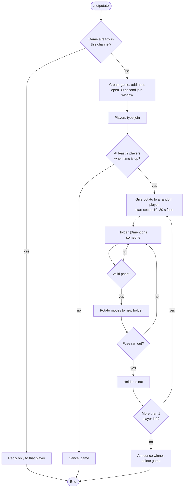
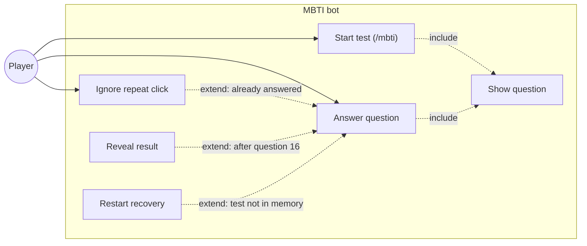

# Arcadia Architecture Guide

Arcadia is a Discord bot that turns a server into a small arcade. Players type a slash command such as `/hangman` and play the game right in the channel. This guide explains how the bot is built, for three readers: a teammate adding a new game, a player curious how it works, and anyone reviewing our code.

## Contents

1. [Overview and system context](#1-overview-and-system-context) (Amrit)
2. [Code design: minigolf modules, and how to add a new game](#2-code-design-minigolf-modules-and-how-to-add-a-new-game) (Abhi)
3. [Game flow: one Hot Potato round](#3-game-flow-one-hot-potato-round) (Jennifer)
4. [Network and tooling: how the bot connects and runs](#4-network-and-tooling-how-the-bot-connects-and-runs) (Jason)

---

## 1. Overview and system context

### What talks to what

Arcadia never runs inside Discord. It is a Node.js program that runs somewhere else (for us, a GitHub Codespace) and keeps a live connection open to Discord. Players only ever see Discord. Discord passes their messages and slash commands to the bot, and the bot sends its replies back through Discord.

| Part | What it does |
|---|---|
| Player | Types commands and guesses in a Discord channel. Needs nothing installed. |
| Discord | Hosts the server and channels. Sends every event the bot asked for to the bot, and shows what the bot sends back. |
| Arcadia bot | Our code. Decides what each event means and what to reply. |
| GitHub Codespace | The cloud computer where the bot actually runs while we develop and demo. |
| GitHub repo | Where the code lives. Every change goes in through a pull request. |

### How the code is organized

The code has two kinds of files, kept in two folders on purpose:

- **`src/games/`** holds the **rules** of each game. These files never talk to Discord. For example, `hangman.js` only knows how to pick a word, check a guess and draw the gallows. Because the rules are plain functions, we can test them with Mocha (`tests/hangman.spec.js`) without a Discord server.
- **`src/events/`** holds the **Discord glue**. Each file listens for one kind of Discord event, reads what the player did, calls the rules in `src/games/`, and sends the answer back.

This split means a bug in "how hangman works" lives in one place, and a bug in "how we talk to Discord" lives in another.

### How the bot starts

1. `npm start` builds the code with esbuild and runs `build/app.js`. The secret bot token comes from the `.env` file.
2. `src/app.js` creates the discord.js `Client`. It asks Discord for four kinds of events (called intents): servers, server members, messages, and the text inside messages.
3. `loadEvents()` in `src/helpers/loadEvents.js` reads **every** `.js` file in `src/events/`. Each file exports an object with a `name` (which Discord event), an `execute` function, and an optional `once`. The loader hooks each one up with `client.on(name, execute)`.
4. The bot logs in. Discord fires the `ready` event once, and `src/events/ready.js` registers the five slash commands (`/hangman`, `/songguess`, `/minigolf`, `/hotpotato`, `/tictactoe`) in every server the bot is in.

The loader in step 3 is the key pattern in this bot. Nobody has to edit `app.js` to add a feature. You drop a new file in `src/events/` and it is picked up the next time the bot starts. Several files can listen to the same event. For example, `messageCreate.js`, `hotpotatoMessages.js` and `songguessMessages.js` all run on every message, and each one ignores messages that are not meant for its game.

### Data flow: one hangman guess

This diagram follows a single typed letter through the system. It uses data flow diagram notation: rounded boxes are things outside our code, plain boxes are steps our code does, and the cylinder is stored data.

Step by step:

1. **Filter.** `messageCreate.js` drops messages from bots (so the bot never answers itself) and anything longer than one character, so people can still chat during a game. It looks up the channel's game in the `games` Map. If that channel has no game, it stops.
2. **Apply the rules.** `guess()` in `hangman.js` lowercases the letter and checks it against the word. It returns one word that says what happened: `invalid`, `repeat`, `hit`, `miss`, `won` or `lost`. It also updates the game object (adds the letter, counts a wrong guess).
3. **Reply.** `messageCreate.js` turns that result into a message. `showGame()` draws the gallows and the hidden word (`p _ x _ l`) inside a code block, so the picture lines up. When the game is won or lost, the game is deleted from the Map so the channel is free for a new one.

A game starts the same way from the other side. `/hangman` arrives as an `interactionCreate` event, and `interactionCreate.js` creates a game and stores it in the Map. If the channel already has a game, it replies only to that player (an ephemeral reply) and does not start a second one.

### Design choices and their limits

- **Games live in memory.** The `games` Map is just a variable. It is fast and simple, but every running game is lost when the bot restarts. A database would fix that, at the cost of more setup.
- **One game per channel.** Keying games by channel ID keeps guesses from different games apart without asking players to type a game ID.
- **Anyone in the channel can guess.** Hangman is a group game, so the bot does not track turns.

---

## 2. Code design: minigolf modules, and how to add a new game

Minigolf is the biggest game in Arcadia, with nine files. Like hangman (section 1), it keeps the game rules apart from the Discord code. The rules are split into small files, and each file has one job.

### What happens on one shot

This diagram follows one shot, from the player clicking **Shoot** to the new picture showing up in Discord. It uses the same shapes as the hangman diagram: rounded shapes are things outside our code, numbered boxes are our files in the order they run, and cylinders are stored data.

In words:

1. **minigolfControls.js** gets every button click. It ignores clicks that aren't minigolf buttons (their ids start with `mg:`) or that come from someone whose turn it isn't. Then it looks up this channel's game.
2. **minigolf.js** takes the shot. It counts the stroke and picks who goes next.
3. **minigolfPhysics.js** rolls the ball. It reads the walls, water and slopes from the hole map in **minigolfCourses.js**, and it uses any traps or cards in play. It reports where the ball stopped and whether it went in.
4. **minigolfRound.js** writes the message about the shot.
5. **minigolfPicture.js** draws a new picture of the course with the ball's path on it. The message, the picture and the next player's buttons go back to Discord.

### What each file does

| File | Its job | Uses Discord? |
|---|---|---|
| `events/minigolfCommand.js` | Starts a game when someone types `/minigolf` | Yes |
| `events/minigolfControls.js` | Handles every minigolf button click | Yes |
| `games/minigolfRound.js` | Writes the messages and buttons, and moves the game from hole to hole | Yes |
| `games/minigolf.js` | Keeps track of the game: players, turns, strokes, scores | No |
| `games/minigolfPhysics.js` | Works out where the ball goes | No |
| `games/minigolfTraps.js` | The traps for Sabotage mode | No |
| `games/minigolfCards.js` | The cards for Chaos Cards mode | No |
| `games/minigolfCourses.js` | The 9 holes, drawn as text maps | No |
| `games/minigolfPicture.js` | Draws the course picture | No |

The six rules files never use Discord. That is why `tests/minigolf.spec.js` can test the physics, traps, cards and scoring without running the bot.

### Ideas worth copying

- **Keep the rules away from Discord.** The rules are plain functions that change a game object. The Discord files only turn clicks into function calls, and results into messages. You can test the rules without a bot, and you can change how messages look without breaking the game.
- **One list of buttons.** Every minigolf button id starts with `mg:`, like `mg:shoot` or `mg:pow:3`. `minigolfControls.js` has one table with one entry per button. A new button is one new entry, not another `if` statement.
- **One game per channel.** Games are kept in memory, one per channel. A restart ends every game.
- **Pass the randomness in.** Anything random (cards, traps, the banana peel's spin) uses a `random` function given to the game. Tests give it fixed numbers, so the results are the same every run.
- **Holes are data.** Each hole is a small text map (`T` tee, `O` cup, `#` wall, `~` water). Adding a hole means drawing a map, not writing code.
- **Ignore double clicks.** The game is marked busy while a shot is being worked out, so a double click can't shoot twice.

### How to add a new game

These are the steps we used for minigolf. Say the new game is `/trivia`.

1. **Write the rules** in `src/games/trivia.js`. Keep them as plain functions, like `createGame()`, `answer(game, player, text)` and `winners(game)`. Don't use `discord.js` in this file.
2. **Test the rules** in `tests/trivia.spec.js`, using Mocha and Chai like the other tests. `npm test` finds the new file on its own.
3. **Connect it to Discord** with a new file in `src/events/`. It exports `{ name: "interactionCreate", execute }` and returns right away if the command or button isn't for trivia. The bot loads every file in this folder on its own.
4. **Add `/trivia` to the command list** in `src/events/ready.js`, or it won't show up in Discord's menu.
5. **Play it** in the test server with `npm start`. Check what happens when two people click at once, and whether some messages should be seen by only one player.
6. **Write the docs**: a `docs/how-trivia-works.md` page and a row in the README's game list.
7. **Open a pull request** to `main`, and a teammate reviews and merges it.

## 3. Game flow: one Hot Potato round

This section shows what each person and part of the system can do in Hot Potato, then walks through one round. The use-case diagram shows the three actors: the **Host** (the player who types `/hotpotato`), any **Player**, and the bot's **Timer**, which triggers steps on its own. Each oval is something an actor can do. A dashed «include» arrow means one step always happens as part of another (starting a game always adds the host). A dashed «extend» arrow means a step only happens sometimes, under the condition in brackets (the winner is announced only when one player is left).

Step by step:

1. **Start.** A player types `/hotpotato`. It arrives as an `interactionCreate` event, and `hotpotatoCommand.js` checks the `games` Map. If the channel already has a game, it replies only to that player (an ephemeral reply) and stops. Otherwise it creates a new game, adds the player who started it, and stores it in the Map.
2. **Join.** The bot opens a 30-second join window. `hotpotatoMessages.js` watches for messages that say `join` and calls `join()` in `hotpotato.js`, which adds the player and returns `joined`, `already` or `closed`. The bot reacts with 🥔 to each new player. Every other message is ignored, so people can still chat.
3. **Close joining.** When the 30 seconds are up, `canStart()` checks for at least 2 players. If there are fewer, the game is cancelled and deleted from the Map.
4. **Hand out the potato.** `startRound()` switches the game to `playing` and gives the potato to a random player. The bot then starts a secret fuse timer. `fuseSeconds()` picks a random length between 10 and 30 seconds, so nobody can predict when it will go off.
5. **Pass.** While the fuse runs, the player holding the potato passes it by @mentioning someone. `pass()` checks three rules in order: the sender must be holding the potato, they can't pass to themselves, and the target must still be in the game. It returns `passed`, `not-holder`, `self` or `not-playing`, and the bot replies to match. A pass from someone who isn't holding the potato gets no reply, so normal chatting doesn't cause spam.
6. **Explode.** When the fuse runs out, `explode()` removes whoever is holding the potato and adds them to the `out` list.
7. **Next round or winner.** If more than one player is left, a new round starts after a 3-second pause (back to step 4). If only one is left, `winner()` returns them, the bot announces the winner, and the game is deleted from the Map so the channel is free for a new one.

### Design choices and their limits

- **Rules and timers are kept apart.** `hotpotato.js` only holds the rules. The timers (`setTimeout`) live in `hotpotatoCommand.js`. That lets the tests call `explode()` directly instead of waiting up to 30 seconds.
- **Timers check that their game still exists.** Before acting, each timer checks the game is still in the Map, so an old timer can't post into a new game.
- **Players are stored by user ID.** IDs never change and are what @mentions contain, so passing works even if someone changes their name.
- **Games live in memory.** Like hangman, a game in progress is lost if the bot restarts.
- **Players who leave stay in the game.** A player who leaves the server mid-game stays in the player list until the potato explodes on them.

---

## 4. Network and tooling: how the bot connects and runs

_ovjason: network diagram (Codespace, token in `.env`, Discord gateway), plus how npm, esbuild and the Docker deploy workflow fit in._
I read the code. It doesn't match the quiz I described in my last reply, so I've rewritten section 3 to fit what you built.

## 5. Game flow: one personality test run

This section shows what each person and part of the system can do in the personality test, then walks through one full run. The use-case diagram shows two actors: the **Player** (anyone who types `/mbti`) and the **Bot**, which posts questions, records answers, and reveals the result. Each oval is something an actor can do. A dashed «include» arrow means one step always happens as part of another (typing `/mbti` always posts question 1). A dashed «extend» arrow means a step only happens sometimes, under the condition in brackets (the result is revealed only after question 16).

### Walkthrough

1. **Player starts the test.** The Player types `/mbti`. The bot replies privately with question 1, which shows the prompt, answers A and B, and two buttons. «include» the test is stored in memory under the Player's ID.
2. **Player answers.** Each click on A or B records one letter for that question, and the bot replaces the message with the next question. Only the Player sees the test.
3. **Bot ignores repeats.** If a button for an earlier question is clicked again, or clicked twice quickly, the bot acknowledges the click and does nothing.
4. **Bot scores the answers.** Each question belongs to one pair of letters (E/I, S/N, T/F, or J/P). For each pair, the letter with more picks wins. A tie goes to the first letter, so E, S, T, or J wins.
5. **Bot reveals the result.** [only after question 16] The bot replaces the last question with the four-letter type, its nickname and summary, and a note that the quiz is not a real diagnosis. The test is then removed from memory.
6. **Restart recovery.** [only if the bot restarted mid-test] A click on an old button gets a message saying the test isn't running and to type `/mbti` again.

### Notes on the code

- The test lives in memory, so a bot restart clears every test in progress. That's noted in the file.
- A test someone abandons halfway is never removed, so the `tests` map grows slowly. Adding a timeout, or clearing the entry when the same user runs `/mbti` again, would fix that.
- Ties always go to E, S, T, and J, which makes the result lean one way when answers are split evenly. If you want that to be neutral, you could tie-break on the most recent answer in each pair.
- Several type nicknames, such as "The Architect," "The Advocate," and "The Campaigner," are names that 16Personalities uses for its own types. If this bot goes public, consider using your own names.

