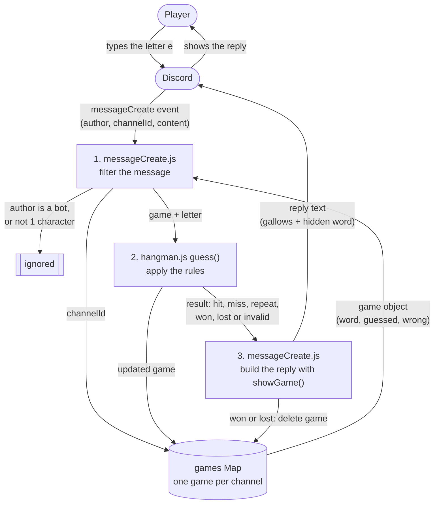
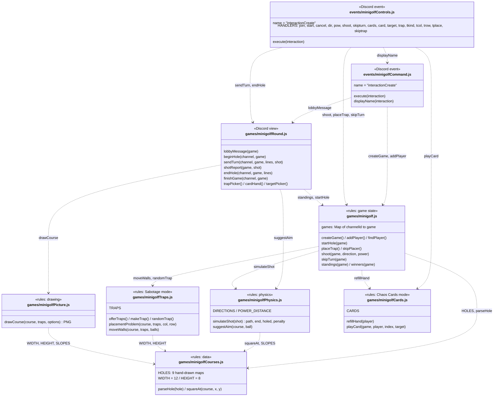
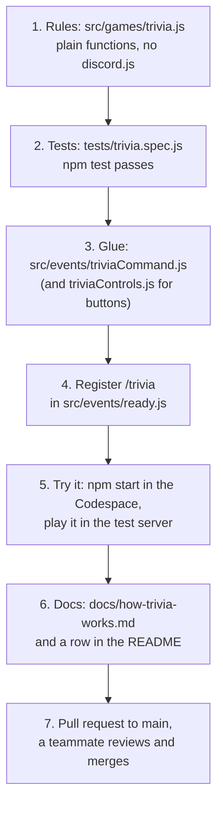

# Arcadia Architecture Guide

Arcadia is a Discord bot that turns a server into a small arcade. Players type a slash command such as `/hangman` and play the game right in the channel. This guide explains how the bot is built, for three readers: a teammate adding a new game, a player curious how it works, and anyone reviewing our code.

## Contents

1. [Overview and system context](#1-overview-and-system-context) (Amrit)
2. [Code design: minigolf modules, and how to add a new game](#2-code-design-minigolf-modules-and-how-to-add-a-new-game) (Abhi)
3. [Game flow: one Hot Potato round](#3-game-flow-one-hot-potato-round) (Jennifer)
4. [Network and tooling: how the bot connects and runs](#4-network-and-tooling-how-the-bot-connects-and-runs) (Jason)

---

## 1. Overview and system context

### What talks to what

Arcadia never runs inside Discord. It is a Node.js program that runs somewhere else (for us, a GitHub Codespace) and keeps a live connection open to Discord. Players only ever see Discord. Discord passes their messages and slash commands to the bot, and the bot sends its replies back through Discord.

| Part | What it does |
|---|---|
| Player | Types commands and guesses in a Discord channel. Needs nothing installed. |
| Discord | Hosts the server and channels. Sends every event the bot asked for to the bot, and shows what the bot sends back. |
| Arcadia bot | Our code. Decides what each event means and what to reply. |
| GitHub Codespace | The cloud computer where the bot actually runs while we develop and demo. |
| GitHub repo | Where the code lives. Every change goes in through a pull request. |

### How the code is organized

The code has two kinds of files, kept in two folders on purpose:

- **`src/games/`** holds the **rules** of each game. These files never talk to Discord. For example, `hangman.js` only knows how to pick a word, check a guess and draw the gallows. Because the rules are plain functions, we can test them with Mocha (`tests/hangman.spec.js`) without a Discord server.
- **`src/events/`** holds the **Discord glue**. Each file listens for one kind of Discord event, reads what the player did, calls the rules in `src/games/`, and sends the answer back.

This split means a bug in "how hangman works" lives in one place, and a bug in "how we talk to Discord" lives in another.

### How the bot starts

1. `npm start` builds the code with esbuild and runs `build/app.js`. The secret bot token comes from the `.env` file.
2. `src/app.js` creates the discord.js `Client`. It asks Discord for four kinds of events (called intents): servers, server members, messages, and the text inside messages.
3. `loadEvents()` in `src/helpers/loadEvents.js` reads **every** `.js` file in `src/events/`. Each file exports an object with a `name` (which Discord event), an `execute` function, and an optional `once`. The loader hooks each one up with `client.on(name, execute)`.
4. The bot logs in. Discord fires the `ready` event once, and `src/events/ready.js` registers the five slash commands (`/hangman`, `/songguess`, `/minigolf`, `/hotpotato`, `/tictactoe`) in every server the bot is in.

The loader in step 3 is the key pattern in this bot. Nobody has to edit `app.js` to add a feature. You drop a new file in `src/events/` and it is picked up the next time the bot starts. Several files can listen to the same event. For example, `messageCreate.js`, `hotpotatoMessages.js` and `songguessMessages.js` all run on every message, and each one ignores messages that are not meant for its game.

### Data flow: one hangman guess

This diagram follows a single typed letter through the system. It uses data flow diagram notation: rounded boxes are things outside our code, plain boxes are steps our code does, and the cylinder is stored data.

Step by step:

1. **Filter.** `messageCreate.js` drops messages from bots (so the bot never answers itself) and anything longer than one character, so people can still chat during a game. It looks up the channel's game in the `games` Map. If that channel has no game, it stops.
2. **Apply the rules.** `guess()` in `hangman.js` lowercases the letter and checks it against the word. It returns one word that says what happened: `invalid`, `repeat`, `hit`, `miss`, `won` or `lost`. It also updates the game object (adds the letter, counts a wrong guess).
3. **Reply.** `messageCreate.js` turns that result into a message. `showGame()` draws the gallows and the hidden word (`p _ x _ l`) inside a code block, so the picture lines up. When the game is won or lost, the game is deleted from the Map so the channel is free for a new one.

A game starts the same way from the other side. `/hangman` arrives as an `interactionCreate` event, and `interactionCreate.js` creates a game and stores it in the Map. If the channel already has a game, it replies only to that player (an ephemeral reply) and does not start a second one.

### Design choices and their limits

- **Games live in memory.** The `games` Map is just a variable. It is fast and simple, but every running game is lost when the bot restarts. A database would fix that, at the cost of more setup.
- **One game per channel.** Keying games by channel ID keeps guesses from different games apart without asking players to type a game ID.
- **Anyone in the channel can guess.** Hangman is a group game, so the bot does not track turns.

---

## 2. Code design: minigolf modules, and how to add a new game

Minigolf is the biggest game in Arcadia: nine files and about 1,900 lines. It follows the same rules/glue split as hangman (section 1), but it has too much code for one rules file. So the rules are cut into small modules, and each module has one job. This section shows how those modules fit together, then turns that into a recipe for adding your own game.

### Module diagram

Each box is one file. The list inside a box is what that file exports (the functions other files call), not every function in it. A dashed arrow means "imports from". The tag on top says which layer the file belongs to.

The files form three layers, and the arrows only point down:

| Layer | Files | Knows about Discord? | Job |
|---|---|---|---|
| Discord events | `minigolfCommand.js`, `minigolfControls.js` | Yes | Catch `/minigolf` and every button click, find the right game, call the layers below. |
| Discord view | `minigolfRound.js` | Yes | Turn a game into messages: text, the course picture, buttons and menus. Moves the game from hole to hole. |
| Rules | `minigolf.js`, `minigolfPhysics.js`, `minigolfTraps.js`, `minigolfCards.js`, `minigolfCourses.js`, `minigolfPicture.js` | No | Plain functions on plain objects. Turns, strokes, ball physics, traps, cards, the course maps, and drawing the PNG. |

The rules layer never imports `discord.js`. That is why `tests/minigolf.spec.js` can run 40 Mocha tests on the rules (physics, traps, cards, scoring) with no bot and no Discord server.

### One shot, through the modules

Here is what happens when a player clicks **Shoot ⛳**:

1. Discord sends an `interactionCreate` event. Every `interactionCreate` file runs. `minigolfCommand.js` ignores it, because it is a button and not a slash command. `minigolfControls.js` keeps it, because the button's id starts with `mg:`.
2. `minigolfControls.js` splits the id `mg:shoot` into the action `shoot`, looks up the game for this channel in the `games` Map, and calls `HANDLERS.shoot`.
3. The handler checks it is really this player's turn, then calls `shoot(game, direction, power)` in `minigolf.js`.
4. `shoot()` asks `simulateShot()` in `minigolfPhysics.js` where the ball goes. Physics reads the map squares through `squareAt()` in `minigolfCourses.js`, applies slopes, walls, water, traps and any card effects, and returns the path, the end square, and whether it went in.
5. `shoot()` adds the strokes, lets the moving walls in `minigolfTraps.js` take a step, and picks whose turn is next.
6. Back in the handler, `minigolfRound.js` writes the shot report and calls `drawCourse()` in `minigolfPicture.js` for a new PNG of the course, with the shot's path drawn on it. Then it sends that with the next player's buttons, or ends the hole if everyone is done.

### Patterns worth copying

- **Rules don't touch Discord.** Game logic is plain functions that take a game object and change it or return a result. The Discord files only translate clicks into function calls and results into messages. You can test the rules, and you can change the look of the messages without breaking the rules.
- **One table of button handlers.** Every minigolf button id is `mg:<action>` (sometimes `mg:<action>:<extra>`, like `mg:pow:3`). `minigolfControls.js` has one `HANDLERS` object with one function per action. A new button means one new id and one new entry in the table, and no growing `if/else` chain. The `mg:` prefix also keeps minigolf from reacting to other games' buttons.
- **One game per channel.** `games` is a `Map` from channel id to game, the same idea as hangman. All of it lives in memory, so a restart ends every game (see "Design choices and their limits" in section 1).
- **Randomness is passed in.** `createGame()` takes a `random` function (default `Math.random`), and everything random uses it: the trap offers, the cards players draw, the banana peel's spin, and the teleporter. Tests pass in a fixed sequence of numbers, so the "random" parts give the same result every run.
- **Data, not code, for courses.** Each hole is a 12 × 8 text map (`T` tee, `O` cup, `#` wall, `~` water, slope arrows). `parseHole()` turns it into a grid. Adding a hole means drawing a new map, not writing new code.
- **No extra image library.** `minigolfPicture.js` writes the PNG pixel by pixel with Node's built-in `zlib`, so the bot needs no native packages that might fail to install in a Codespace or a Docker image.
- **A `busy` flag on the game.** While a shot is being processed, more clicks are ignored, so a double click can't shoot twice.

### How to add a new game

This is the checklist we used for minigolf, and it works for any game. Say the new game is `/trivia`.

1. **Write the rules in `src/games/trivia.js`.** Keep the game in a plain object, and export functions like `createGame()`, `answer(game, player, text)` and `winners(game)`. Do not import `discord.js` here. Export a `games = new Map()` keyed by channel id if the game is one per channel. Take a `random` argument wherever you would call `Math.random`.
2. **Test the rules in `tests/trivia.spec.js`.** Use Mocha and Chai (`import { expect } from "chai"`), like the other spec files. `npm test` picks up every `*.spec.js` file in `tests/` on its own.
3. **Add the Discord glue in `src/events/`.** Make a file that exports `{ name: "interactionCreate", execute }`. Return right away if the interaction isn't yours: `if (interaction.commandName !== "trivia") return;` for the slash command, or `if (!interaction.customId.startsWith("tv:")) return;` for buttons. `loadEvents()` finds the file on its own, so you never edit `app.js`. If players type answers in chat, listen to `messageCreate` instead, and ignore bots and other channels the way `messageCreate.js` does.
4. **Register the slash command in `src/events/ready.js`.** Build it with `SlashCommandBuilder` (name, description, any options), add `triviaCommand.toJSON()` to the list in `guild.commands.set([...])`, and add `/trivia` to the log line under it. If you skip this step, Discord never shows `/trivia` in the menu.
5. **Try it for real.** Run `npm start` in the Codespace and play a full game in the test server. Look for buttons that need to be disabled, messages only one player should see (`ephemeral: true`), and two people clicking at once.
6. **Document it.** Write `docs/how-trivia-works.md` in the same style as the other docs, and add the command to the table in `README.md`.
7. **Open a pull request.** Branch from `main`, push, and open a PR. A teammate reviews it and merges it.

---

## 3. Game flow: one Hot Potato round

_cpukarma: activity diagram of one round, from start to the potato exploding._

---

## 4. Network and tooling: how the bot connects and runs

_ovjason: network diagram (Codespace, token in `.env`, Discord gateway), plus how npm, esbuild and the Docker deploy workflow fit in._
