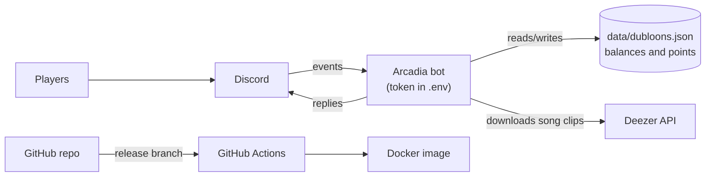

# Arcadia Code Analysis Report

Shared report for Bot Project Task 5. Each team member adds a section for the
two analysis jobs they picked. Add your section under its heading and put your
name next to it.

| Job | Topic | Who |
|---|---|---|
| 1 | Code Examination | Jason and Kristine |
| 2 | Cyclomatic complexity | Abhi |
| 3 | Cohesion and coupling | Kristine |
| 4 | Test coverage | Jennifer |
| 5 | Threat model | Jennifer |
| 6 | Fuzzer | Ami |
| 7 | Unit tests | Abhi |
| 8 | Smoke test | Ami |
| 10 | Bot Additions | Jason |

---
## 1. Code Examination: technical debt and code smells (Jason and Kristine)

### What it covers

Technical debt is code that works today but makes future changes slower, riskier
or more expensive. A code smell is a pattern in the code that usually points to
that kind of debt. This section lists the smells and debt we found in the bot,
why each one matters, and how to fix it.

### How it was examined

- Read through the files in `src/` by hand, looking for long functions,
  duplicated logic, hardcoded values, unclear names, dead code and shortcuts.
- Searched for leftover markers: `grep -rn "TODO\|FIXME\|HACK" src`
  
### Findings

| # | Smell | Where | Why it matters | Proposed fix |
|---|---|---|---|---|
| 1 | **Long method** | `simulateShot`, `src/games/minigolfPhysics.js` (46) | Movement, bounces, traps and stopping are all in one loop. | Split into `moveBall`, `bounceOffWalls`, `applyTrap`, `isStopped`. |
| 2 | **Long `if`/`else if` chain** | `playCard`, `src/games/minigolfCards.js` (24) | Every new card adds a branch. | Lookup table of card name to handler. |
| 3 | **Mixed responsibilities** | `hotpotatoMessages.execute`, `messageCreate.execute` | Validation, state and replying are in one function, so it can't be tested without Discord. | Pull logic into pure functions. |
| 4 | **Code that cannot be tested** | `drawTrap`, `runStep` (not exported) | Complex logic with no direct tests. | Export or extract helpers. |
| 5 | **Untested complex code** | `shotReport`, `cardHand`, `hotpotatoMessages.execute` | Refactors are risky without tests. | Add tests first. |

---

## 2. Cyclomatic complexity (Abhi)

### What it measures

Cyclomatic complexity counts the independent paths through a function: one
for the function itself plus one for every `if`, `else if`, loop, `case`,
`&&`, `||`, `??` and `?:`. A higher number means more paths to understand
and more test cases needed to cover every branch. A common rule of thumb is
1 to 10 is fine, 11 to 20 is getting hard to follow, and over 20 should be
split up.

### How it was measured

ESLint's built-in `complexity` rule, run over every file in `src/` with the
threshold set to 1 so that every function gets reported:

```bash
npx eslint --no-config-lookup --rule '{"complexity":["warn",1]}' -f json src
```

The JSON output was then sorted by score. This was run on `main` at commit
`0e72a1d`.

### Results

161 functions were measured. The average complexity is **4.25**.

| Complexity | Functions | Share |
|---|---|---|
| 1 to 5 (simple) | 130 | 81% |
| 6 to 10 (moderate) | 25 | 16% |
| 11 to 20 (complex) | 4 | 2% |
| 21 or more (very complex) | 2 | 1% |

The 10 most complex functions:

| Score | Function | File | Has unit tests? |
|---|---|---|---|
| 46 | `simulateShot` | `src/games/minigolfPhysics.js` | Yes |
| 24 | `playCard` | `src/games/minigolfCards.js` | Yes |
| 19 | `drawCourse` | `src/games/minigolfPicture.js` | Yes |
| 12 | `drawTrap` | `src/games/minigolfPicture.js` | No (not exported) |
| 11 | `execute` | `src/events/hotpotatoMessages.js` | No |
| 11 | `placementProblem` | `src/games/minigolfTraps.js` | Yes |
| 10 | `startHole` | `src/games/minigolf.js` | Yes |
| 10 | `shotReport` | `src/games/minigolfRound.js` | No |
| 10 | `moveWalls` | `src/games/minigolfTraps.js` | Yes |
| 9 | `runStep` | `src/events/horseraceInteraction.js` | No (not exported) |

### Findings

1. **Most of the code is simple.** 81% of functions score 5 or less, so the
   codebase is easy to read overall. The game logic is mostly kept apart from
   the Discord code, which keeps those functions small.
2. **Mini golf holds almost all of the complexity.** 8 of the top 10 functions
   are in the mini golf files. `simulateShot` (46) is more than four times the
   recommended limit of 10. It handles movement, wall bounces, every trap type
   and stopping the ball in one loop.
3. **`playCard` (24) is a long chain of `if`/`else if` on the card type.** Each
   new card adds another branch, so it will keep growing.
4. **Some complex functions have no tests.** `shotReport` (10) and `cardHand`
   (8) in `minigolfRound.js` are exported but untested. `drawTrap` (12) and
   `runStep` (9) are not exported, so they can't be unit tested directly.
   `hotpotatoMessages.execute` (11) runs on every message and is untested.
5. **Event handlers are the next hot spot.** `messageCreate.execute` (9) and
   `hotpotatoMessages.execute` (11) mix checking the message, game state and
   replying in one function.

### Recommendations

- Split `simulateShot` into smaller helpers, for example `moveBall`,
  `bounceOffWalls`, `applyTrap` and `isStopped`. Each one is then easy to test
  on its own, and the loop becomes a few lines.
- Replace the `if`/`else if` chain in `playCard` with a lookup table that maps
  each card name to a small function. Adding a card then adds no branches.
- Add unit tests for `shotReport` and `cardHand` before refactoring them.
- Export `drawTrap` and `runStep` (or move their logic into a pure helper) so
  they can be tested.
- Add `"complexity": ["warn", 15]` to the ESLint config so new functions over
  15 get flagged in review.

---

## 7. Unit tests (Abhi)

### What was there

`tests/tictactoe.spec.js` had 6 tests. It checked a row win, a draw, an
unfinished game, a taken square, the player winning and the hard bot blocking.
It did not check column or diagonal wins, the bot winning, the easy bot, or
the `lost`, `continue` and last-square results of `playTurn`.

### What was added

`tests/tictactoeEdgeCases.spec.js` adds 10 unit tests for
`src/games/tictactoe.js`:

| Test | What it proves |
|---|---|
| starts a new game on hard with an empty board | `createGame` defaults are right |
| detects a column win | column lines in `WIN_LINES` work |
| detects both diagonal wins | both diagonals work |
| detects a win for the bot (O) | `checkWinner` works for O, not just X |
| easy bot always picks an open square | the random bot never picks a taken square |
| hard bot takes a winning square instead of blocking | minimax prefers winning over blocking |
| returns continue after a normal move | the bot answers with exactly one move |
| returns lost when the player does not block | `playTurn` reports a bot win |
| returns draw when the last square fills the board | `playTurn` reports a draw |
| counts a win on the last square as a win | a win is checked before a draw |

### How to run

```bash
npm test
```

All tests pass, including the existing suites.

### Why these tests

Tic tac toe's `checkWinner` and `playTurn` are pure functions (no Discord
calls), so they are the easiest code in the bot to test reliably. The new
tests cover every return value of `playTurn` and every kind of win line, which
gives full branch coverage of the game logic outside of `minimax`'s inner
loop.

---

## 4. Test coverage (Jennifer)

### What it measures

Test coverage is the share of the code that actually runs while the tests run.
If a line never runs during `npm test`, no test can catch a bug in it. Coverage
is reported four ways:

- **Lines / statements:** how many lines ran at least once
- **Branches:** how many sides of each `if`, `?:`, `&&` and `||` were taken
- **Functions:** how many functions were called at least once

High coverage doesn't prove the code is correct (a test can run a line without
checking its result), but low coverage shows exactly where bugs could hide.

### How it was measured

[c8](https://github.com/bcoe/c8), which uses Node's built-in coverage, run over
every file in `src/` (including files no test imports, thanks to `--all`):

```bash
npm run coverage
```

That script runs:

```bash
c8 --all --include=src/** --reporter=text --reporter=html mocha -r esbuild-register ./tests/*.spec.js --exit
```

A table prints in the terminal, and a clickable report is saved to
`coverage/index.html`. This was run on `main` at commit `26f8754`, with all 129
tests passing.

**Setup problem found along the way:** running c8 with our normal `npm test`
reported **0% for every file**. Our test runner, `esbuild-runner`, converts the
code before running it but doesn't produce source maps, so c8 can't match the
results back to our files. Switching the coverage script to `esbuild-register`,
which does produce source maps, fixed it. `npm test` itself is unchanged.

### Results

Overall: **56% of lines**, **88% of branches**, **72% of functions**.

By folder:

| Folder | What's in it | Lines covered |
|---|---|---|
| `src/games/` | Game rules | **80.5%** (2,634 / 3,272) |
| `src/economy/` | Dubloons and points | **64.4%** (322 / 500) |
| `src/events/` | Discord handlers | **0%** (0 / 1,434) |
| `src/helpers/` | Loading event files | **0%** (0 / 38) |
| `src/app.js` | Starting the bot | **0%** (0 / 20) |

Files worth noting:

| File | Lines | Notes |
|---|---|---|
| `games/hotpotato.js` | 100% | Only one branch in `winner()` not taken |
| `games/horserace.js` | 100% | |
| `economy/rates.js` | 100% | |
| `economy/wallet.js` | 100% | |
| `games/minigolf.js` | 99% | |
| `games/hangman.js` | 92% | Lines 115-125 not reached |
| `games/poker.js` | 89% | Only 52% of functions called |
| `games/songguess.js` | 86% | Lines 177-209, the Deezer download code, not reached |
| `games/minigolfCards.js` | 84% | Several card types never played in a test |
| `games/tictactoe.js` | 61% | Lines 170-231, the Discord buttons, not reached |
| `economy/bank.js` | 59% | Only 1 of 18 helper functions called |
| `games/minigolfRound.js` | **0%** | 341 lines, no test imports it |
| `games/songguessRound.js` | **0%** | 64 lines, no test imports it |
| `economy/commands.js` | **0%** | `/points`, `/convert`, `/leaderboard` |

### Findings

1. **The game rules are well tested.** 80% of the lines in `src/games/` run
   during the tests, and four files reach 100%. Keeping the rules apart from
   Discord code (see ARCHITECTURE.md) is what makes this possible.
2. **Nothing that talks to Discord is tested.** Every file in `src/events/`
   is at 0%. That's 1,434 lines, about **27% of the whole bot**, including the
   code that reads players' messages and button clicks. A typo there would pass
   every test and only show up when someone plays.
3. **Two whole game files have no tests at all.** `minigolfRound.js` (341
   lines) and `songguessRound.js` (64 lines) are never imported by a test.
   This matches the complexity report: `shotReport` (complexity 10) lives in
   `minigolfRound.js`.
4. **The dubloon commands are untested.** `economy/commands.js` is at 0% and
   `bank.js` only has 1 of its 18 helpers called. These change players'
   balances and save them to disk, so a bug could cost people dubloons.
5. **Code that mixes rules and Discord is harder to cover.** `tictactoe.js`
   keeps its button handling in the same file as its rules, and its coverage
   (61%) is the lowest of the games that have tests.
6. **Our tooling hid the real numbers.** Until the source map fix, coverage
   looked like 0% everywhere, so nobody could have used it in code review.

### Recommendations

- Add unit tests for `minigolfRound.js` and `songguessRound.js` first, since
  they are pure rules code at 0% and should be easy to test.
- Test the dubloon commands in `economy/commands.js`, and the `bank.js`
  helpers, using a temporary file for `DUBLOONS_FILE` so real balances aren't
  touched.
- For `src/events/`, test with fake Discord objects (a plain object with a
  `reply` function that records what it was called with), starting with
  `hotpotatoMessages.js`, which also has the highest complexity of any event
  handler (11).
- Move tic tac toe's button code into `src/events/` so the rules file can be
  fully covered, like the other games.
- Run `npm run coverage` in GitHub Actions on every pull request so the
  numbers are visible in review.

---

## 5. Threat model (Jennifer)

### Method

This threat model follows the four questions from the Threat Modeling
Manifesto and uses **STRIDE** to answer "What can go wrong?":

| Letter | Threat | Property it breaks |
|---|---|---|
| S | Spoofing | Authentication (who you are) |
| T | Tampering | Integrity (data stays correct) |
| R | Repudiation | Proof of who did what |
| I | Information disclosure | Confidentiality |
| D | Denial of service | Availability |
| E | Elevation of privilege | Authorization (what you're allowed to do) |

### 1. What are we working on?

Arcadia runs as one Node.js program that connects to Discord over the gateway.



**What's worth protecting:**

- The **bot token**. Anyone who has it can run a bot as Arcadia.
- **Players' dubloons and game points** in `data/dubloons.json`.
- The bot **staying online** and games working.
- The **code** in our repo and the Docker image built from it.

**Trust boundaries** (where data comes from someone we don't control):
players' messages and button clicks, the Deezer API, and anyone who can push
to the repo.

### 2. What can go wrong?

| # | STRIDE | Threat | Already in place | Risk |
|---|---|---|---|---|
| 1 | Spoofing | The bot token leaks, for example by being pasted into a commit or a chat, and someone runs a fake Arcadia | `.env` is in `.gitignore`; `.env-sample` has no real token | High impact, low chance |
| 2 | Spoofing | One person joins hot potato, horse race or poker with **alt accounts** to farm points, then converts them to dubloons and climbs `/leaderboard` | Hot potato needs 2+ players, but doesn't check they're different people | Medium |
| 3 | Tampering | `data/dubloons.json` is unreadable (bad edit, disk problem). `bank.js` logs an error, starts an **empty bank**, and the next save **overwrites the old file**, wiping everyone's balances | Saves use a temp file and rename, so a crash mid-save can't corrupt it | Medium |
| 4 | Tampering | Someone pushes harmful code straight to `main` | Pull requests and review are our habit, but nothing forces them | Medium |
| 5 | Repudiation | A player says "I bet 500 and lost it unfairly" and there's no record to check | Only the final balance is saved, no history | Low |
| 6 | Information disclosure | `/points` is private, but `/leaderboard` shows everyone's balance in the channel | `/points` replies are ephemeral | Low (game money only) |
| 7 | Denial of service | One user spams commands in many channels. "One game per channel" only limits each channel, and there's no per-user cooldown | One game per channel; bot messages ignored | Medium |
| 8 | Denial of service | **Redeploying wipes all dubloons.** The Docker image doesn't keep `data/` anywhere outside the container, so every new container starts with an empty bank | `data/` is kept out of git | High |
| 9 | Denial of service | The Deezer API is down or changes, and `/songguess` stops working | Depends on Deezer; error handling not covered by tests (see section 4) | Low |
| 10 | Elevation of privilege | A player clicks buttons or sends messages for a game or hand that isn't theirs | Poker checks "that's not your hand"; hot potato's `pass()` checks the holder | Low |
| 11 | Elevation of privilege | The bot is invited with more Discord permissions than it needs | The README invite link asks only for the permissions the games use | Low |
| 12 | Bets | A negative or fractional bet adds dubloons | `spendDubloons` rejects anything that isn't a whole number above 0 | Low, already handled |

### 3. What are we going to do about it?

In order of priority:

1. **Keep dubloons across redeploys (#8).** Mount a volume for `/app/data` in
   the deployment, or move the bank to a hosted database.
2. **Don't wipe balances when the file can't be read (#3).** If loading fails
   for any reason other than "file doesn't exist," copy the bad file to
   `dubloons.json.broken` before saving anything, or stop the bot with a clear
   error.
3. **Add a per-user cooldown (#7)**, for example one new game every 30 seconds
   per user, across all channels.
4. **Turn on branch protection for `main` (#4)**, requiring one approving
   review, and turn on GitHub **secret scanning** (#1).
5. **Limit point farming (#2)** by capping points per user per hour, or only
   giving points when players have been in the server for a while.
6. **Keep a simple log of bets and payouts (#5)** so disputes can be checked.

### 4. Did we do a good enough job?

This model covers the main parts of the bot, but it was done by one person
from reading the code. It should be **revisited whenever a feature is added**
("continuous refinement over a single delivery"), especially features that
touch dubloons. Threats #3 and #8 should get tests or a deployment check
before more economy features are added.

--- 
## 10. Bot Additions (Jason)

### What to Add

We need to add more integration with each game within the bot in itself. Our games currently work independently, so a win in one has no connection to the others. The bot feels like separate minigames and not an arcade. In order to make it have a more arcade like experience there should be a point system added where you can win money/points to use in other games or to buy things to potetnailly enhance the experience of other games like power-ups and items.

### Scope

A shared points module that all games call to award points, instead of each game handling scoring itself.
Persistent storage of each player’s total points so they survive a bot restart.
A consistent points table across games, for example a win, a draw and participation, with harder bot difficulty earning more.
A /points command to see your own total and a /leaderboard command for the top players.

---

## 6. Fuzzer (Ami)

### What a fuzzer is

A normal unit test checks one example picked by hand. A fuzzer makes up
hundreds of random examples and checks that a rule holds for every one of
them. When a rule breaks, it shrinks the example down to the smallest one
that still breaks it, which makes the bug easy to see.

### What was fuzzed

`tests/horseraceFuzz.spec.js` uses [fast-check](https://fast-check.dev/) to
fuzz the horse race rules in `src/games/horserace.js`. Horse race was picked
because it moves real dubloons, so a bug there costs players money. Each rule
runs 100 random examples by default.

| Rule (property) | Random input | Result before fix |
|---|---|---|
| Betting never creates or destroys dubloons | 4 players with 0 to 200 dubloons, up to 40 clicks | Pass |
| Nobody's dubloons go below 0 | same | Pass |
| A horse gallops 0 to 3 steps | any `Math.random` value | Pass |
| A horse never moves backwards or past the line | 50 steps of random numbers | Pass |
| Payout = bets on the winner x its odds | up to 40 clicks, then a full race | Pass |
| A horse that doesn't exist never takes dubloons | horse numbers like 5, -1, 2.5 and NaN | **Fail** |
| A broken click doesn't change the next real bet | a bad click, then a good one | **Fail** |

### Findings

1. **`placeBet` trusted the horse number.** Given a horse number outside 0 to
   4 (fast-check shrank it to `placeBet(game, wallets, "ana", 5)`), it still
   took 10 dubloons, and the bet went on a horse that can't win, so the
   dubloons were gone for good. A `NaN` horse did the same and also turned the
   bet totals into `NaN`. The number comes from the button ID (`"horse:2"`),
   so today only a renamed or broken button would trigger it, but nothing
   stopped it.
2. **The money math is solid.** Across every random run, dubloons were never
   created or lost during betting, no wallet went negative, and payouts
   always matched the odds exactly.
3. **`pickWinner` returns `undefined` if no horse has finished.** The Discord
   code only calls it after someone crosses the line, so it doesn't crash
   today, but `payOut` would throw if it were ever called early.

### What was fixed

`placeBet` now returns `"invalid"` and takes nothing unless the horse is a
whole number from 0 to 4, and the button handler replies "That horse isn't
in this race." Both failing rules pass now.

## 8. Smoke test (Ami)

### What a smoke test is

A quick "does it turn on?" check. It doesn't test every rule; it runs the
main job of each part of the bot once and makes sure nothing crashes.

### What it covers

`tests/smoke.spec.js` has 10 checks and needs no Discord token or internet:

| Check | What it proves |
|---|---|
| Every file in `src/events/` loads with a `name` and `execute` | the bot can start (a typo in any event file would stop `npm start`) |
| Hangman to a win | guesses and winning work |
| Hot potato until one player is left | join, start, pass, explode and winner work |
| One turn of tic tac toe | the player moves and the bot answers |
| Slot machine spin | three reels and a payout |
| Poker deal, hold, draw and payout | a full hand works |
| Song guess check | title matching works (song is made up, no Deezer call) |
| A hole of minigolf | a player can join, shoot and finish a hole |
| Horse race from bet to payout | bets, racing, winner and payout work |
| Points to dubloons | `/convert` math works |

### Findings

1. **Every game's main flow works**, and every event file loads.
2. **Horse race bets are lost if the bot restarts mid-race.** Bets are taken
   out of the saved dubloons file right away, but the race itself only lives
   in memory. If the bot stops during the 25 seconds of betting or the race,
   nobody gets paid or refunded.
3. **Song guesser can't be smoke tested end to end without the internet**,
   because `getRandomSong` always calls Deezer. Passing in the song source
   would let a test use a fake one.

### How to run

```bash
npm install
npm test
```

### User stories from this work

- Refuse bets on horses that don't exist (fixed in this change)
- Refund horse race bets when the bot restarts mid-race

---

## 1 & 3 Technical debt, cohesion and coupling (Kristine)

### What I measured

- **Technical debt:** read the files that the existing sections didn't cover, and checked for layering problems, duplicated helpers and leftover TODOs.
- **Cohesion and coupling:** counted the `import` lines in every file under `src/` (fan-out), and counted how many files import each shared module (fan-in). I also checked which files call Discord APIs and which files award points or touch dubloons. I did this with `grep` and by reading the code. I did not run a dependency tool, so the numbers are counts, not standard metrics.

Time spent: [2 HOURS]

### Coupling: the shared hubs

| Module | Fan-in (files that import it) | Why it matters |
|---|---|---|
| `src/economy/bank.js` | 8 | Every game that pays out depends on it. It loads and saves the file, awards and spends dubloons, converts points, and formats text (`dubloonText`, line 93). A change to any of those hits all 8 callers. |
| `src/economy/earnings.js` | 5 | Holds each game's point values. Stable and easy to change. |
| `src/games/minigolf.js` | 3 | The mini golf entry point. Most mini golf code depends on it indirectly. |
| `src/games/songguess.js` | 3 | Imported by its own commands, messages and `ready.js`. |

Two of the ARCHITECTURE.md claims don't match the code:

- **"Games never talk to Discord"** (ARCHITECTURE.md, section 1) is false for three files:
  - `src/games/tictactoe.js` builds Discord buttons (lines 136–160), reads `interaction.options` (line 173) and handles button clicks (`handleInteraction`, line 221). It has 25 Discord-related lines.
  - `src/games/minigolfRound.js` builds the button rows (lines 335–340) and calls `message.edit` (line 209).
  - `src/games/songguessRound.js` creates `AttachmentBuilder` clips (line 16).
- **"Game state lives in games/"** is only partly true. The poker and horse race maps are in the events layer: `src/events/pokerInteraction.js:37` and `src/events/horseraceInteraction.js:36`.

### Cohesion: files that do too much

- **`src/games/minigolfRound.js` (341 lines, 16 exports)** has six jobs: lobby (lines 46–66), point awards (97–107), turn flow (131–207), trap placement (214–297), the card hand (298–334) and the picture (119–130). Each job changes for a different reason, so the file has low cohesion.
- **`src/economy/bank.js`** handles storage, currency rules and display text in one module (see the table above).
- **`src/events/minigolfControls.js` (234 lines, 40 Discord-related lines)** imports `displayName` from `src/events/minigolfCommand.js:33`, so one event file depends on another. A small display helper belongs in a shared place.

### Technical debt found

These don't repeat the smells already listed in this report (`simulateShot`, `playCard`, `hotpotatoMessages.execute`, and so on).

1. **Points are awarded from six places.** `awardPoints` is called in `messageCreate.js:34`, `songguessMessages.js:28`, `hotpotatoCommand.js:78`, `minigolfRound.js:99` and `tictactoe.js:213`. Some are in events and some are in games, so there is no single rule for where scoring happens. This is the main reason the bot feels like separate games, which is why the proposed shared points module (job 10) matters.
2. **Button helpers are copied.** Five files import `ButtonBuilder` directly (`minigolfRound`, `tictactoe`, `horseraceInteraction`, `slotsInteraction`, `pokerInteraction`), and each builds its own rows. `minigolfRound.js` has private `row` and `button` helpers (lines 335–340) that nothing else can reuse.
3. **The name `games` is reused.** Seven modules each define a `games` Map. That's confusing when reading imports, and it makes it harder to see which game a file means.
4. **`describe` is exported from `songguessRound.js:57`.** That name is also a Mocha test global, so importing it in a test file can be confusing.

### Proposed fixes

- Move the Discord-specific code (button rows, `interaction` handlers, attachments) out of `src/games/` and into `src/events/`, starting with `tictactoe.js`. This matches ARCHITECTURE.md and makes the rules files fully testable.
- Have one points module (`src/economy/points.js`) own all scoring, and have games return results instead of calling `awardPoints` directly.
- Split `minigolfRound.js` into lobby, turn, trap and card files.
- Move `dubloonText` into a formatting helper so `bank.js` only handles storage and balances.
- Move `displayName` to a shared helper module.

### What I did not measure

Lack of cohesion (LCOM) and the instability metric were not computed. The fan-in counts come from a text search of `import` lines, so any dynamic `import()` or `require()` call inside a function would be missed.

### User stories from this work

- Keep the mbti test alive across restarts
- Clear abandoned tests

---
